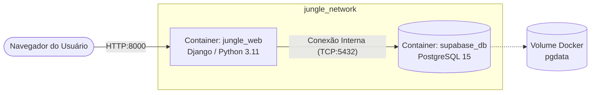

# Python + Supabase (Docker)

O objetivo do projeto é integrar uma aplicação web em Python (Django) com um banco de dados PostgreSQL (simulando o ambiente Supabase), com ambos os serviços rodando em contêineres Docker e se comunicando através de uma rede interna.

## Arquitetura do Projeto

O sistema é composto por dois contêineres isolados em uma rede customizada (`jungle_network`), garantindo que a aplicação web se conecte ao banco de dados de forma segura sem expor a conexão diretamente.

## Como rodar:
1) Suba a infraestrutura usando o Docker Compose:
docker compose up --build

2) Acesse a aplicação através do link:
http://localhost:8000
